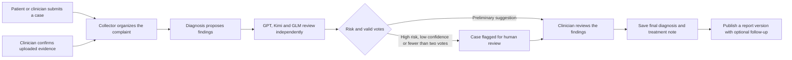

# MedConsensus

MedConsensus is a medical decision-support workspace for clinicians and patients. A patient can submit a complaint and supporting documents. The clinician reviews the sources and independent model opinions, records a final assessment, and publishes a report the patient can revisit.

> ⚕️ **Clinical safety.** A qualified clinician must confirm every diagnosis and medication recommendation. The patient portal supports consultation and follow-up. It does not provide self-diagnosis or automatic prescribing.

[中文](README.md) · [Project guide](docs/project-guide.md) · [Deployment guide](docs/deployment.md) · [MIT License](LICENSE)

[](https://www.oracle.com/java/)
[](https://spring.io/projects/spring-boot)
[](https://react.dev/)
[](https://vite.dev/)
[](https://www.postgresql.org/)

## 🧭 Choose a path

| If you want to… | Start here | You will get |
| --- | --- | --- |
| Try the workspace locally (recommended) | [Local development](#-local-development) | A React UI at `http://localhost:5173` |
| Connect a host-run backend to the data services | [Supporting services](#1-start-the-supporting-services) | Connection details for PostgreSQL, Redis, and Neo4j |
| Prepare a server deployment | [Deployment guide](docs/deployment.md) | Compose setup, provider credentials, health checks, and upgrades |

## 🔎 Core workflow



Patients request a clinician connection by invite code. Once the clinician accepts, the patient can start a consultation and respond to questions. Clinicians see progress over STOMP at `/ws/diagnosis` through their `/user/queue/pipeline` subscription.

## ✨ Capabilities

- **Evidence review.** Open the original PDF, DOCX, JPEG, or PNG beside the extracted findings, check available page or location references, and correct the text before confirming it. Each published report version retains its evidence references. The workflow can also draw on pgvector and the Neo4j medical knowledge graph.
- **Independent model review.** The decision stage weights valid GPT, Kimi, and GLM votes. A timeout or invalid response appears as an absent vote. Fewer than two valid votes, high risk, or low confidence routes the case to a clinician.
- **Consultation history.** PostgreSQL stores the complete consultation message history, diagnostic snapshot, and session status. Clinicians can reopen a session after a restart. Drafts and attachments in the workspace stay with their patient or session.
- **Report revisions.** Clinicians can export a labeled draft, save their review, and publish it to the patient. Publishing a correction creates another version. Earlier published conclusions and their supporting evidence remain available.
- **Follow-up and work queue.** Clinicians can set a due date and instructions when publishing a report. Patients submit results against that report version. Clinicians can filter their queue by evidence awaiting confirmation, cases awaiting review, reports ready to publish, and follow-up results awaiting acknowledgment.
- **Observability.** LangSmith and OpenTelemetry tracing are optional. Trace content capture is disabled by default.

## 🧱 Technology stack

| Layer | Components |
| --- | --- |
| Backend | Java 17, Spring Boot 3.3.0, Spring AI OpenAI Starter 1.0.0-M6, LangGraph4j 1.5.14 |
| Frontend | React 18.3, Vite 5, STOMP WebSocket |
| Data and infrastructure | PostgreSQL + pgvector, Flyway, Redis, Neo4j, Docker Compose |
| Observability and documents | OpenTelemetry, LangSmith (optional), PDFBox, Apache POI |

## 🚀 Local development

### Prerequisites

- Java 17 and Maven
- Node.js 20 for the frontend
- PostgreSQL with pgvector, Redis, and Neo4j reachable from the machine running Maven
- `API_KEY` and `OPENAI_API_KEY` for the complete diagnosis workflow. Configure `MIMO_API_KEY` to use MiMo for treatment suggestions.

### 1. Start the supporting services

The local defaults use PostgreSQL at `localhost:5432`, Redis at `127.0.0.1:6379`, and Neo4j at `bolt://localhost:7687`. Create the `medconsenus` business database and prepare the separate `vector_db` database with pgvector. Flyway creates and upgrades the business tables at application startup. Hibernate validates the schema.

The deployment Compose file exposes these three services only inside the Compose network. To run Maven on the host with those containers, publish their ports to loopback in a local Compose override or point the application at other host-reachable services. The PostgreSQL container initializes the vector database and embedding table on its first start with an empty data volume. [Compose configuration](docker/deploy/docker-compose.yml)

### 2. Start the backend

From the repository root, set the service credentials in the shell that runs Maven. This Bash example assumes both PostgreSQL databases use the same account.

```bash
export POSTGRES_USER=postgres
export POSTGRES_PASSWORD=your_postgres_password
export PGVECTOR_USER="$POSTGRES_USER"
export PGVECTOR_PASSWORD="$POSTGRES_PASSWORD"
export NEO4J_PASSWORD=your_neo4j_password
export API_KEY=your_dashscope_api_key
export OPENAI_API_KEY=your_openai_api_key
export MIMO_API_KEY=your_mimo_api_key       # optional
mvn spring-boot:run
```

The backend listens on port `8086`. Check its health endpoint from another terminal.

```bash
curl http://127.0.0.1:8086/actuator/health
```

### 3. Start the frontend

From the repository root in a separate terminal, start Vite.

```bash
cd frontend
npm ci
npm run dev
```

Open [the local workspace](http://localhost:5173). Choose **Doctor** or **Patient**, then sign in or register with a phone number and password. Vite proxies `/api` and `/ws` to `http://127.0.0.1:8086`.

WeChat and QQ offer OAuth sign-in. After role selection, the login page shows the providers enabled for this deployment. On first authorization, enter the phone number and password of an existing local account for that role to link it. Subsequent authorizations open the linked workspace.

Run the frontend tests and build the assets served by Spring Boot from `frontend/`.

```bash
node --test
npm run build
```

To run the backend tests from the same shell, return to the repository root.

```bash
cd ..
mvn test
```

## ⚙️ Configuration

Override application defaults with environment variables. [Application configuration](src/main/resources/application.yml)

| Variable | Purpose |
| --- | --- |
| `API_KEY` | DashScope-compatible Collector, reviewer, Decision, and embedding models |
| `OPENAI_API_KEY` | GPT diagnosis, review, and vision models |
| `MIMO_API_KEY` | MiMo treatment suggestions |
| `SPRING_DATASOURCE_URL`, `POSTGRES_USER`, `POSTGRES_PASSWORD` | PostgreSQL business database |
| `PGVECTOR_HOST`, `PGVECTOR_PORT`, `PGVECTOR_DATABASE`, `PGVECTOR_USER`, `PGVECTOR_PASSWORD` | Separate vector database connection |
| `REDIS_HOST`, `REDIS_PORT` | Redis locks, report explanation history, and legacy session migration |
| `NEO4J_URI`, `NEO4J_USER`, `NEO4J_PASSWORD` | Medical knowledge graph |
| `WECHAT_LOGIN_ENABLED`, `QQ_LOGIN_ENABLED` | Enable WeChat or QQ website login independently. Both default to `false`. |
| `LANGSMITH_ENABLED`, `LANGSMITH_API_KEY` | Optional LangSmith tracing |

To enable a login provider, register a website application, set its app ID and server-side secret, and configure the public HTTPS callback for the same site. The deployment guide lists the variables and callback paths for both providers. [WeChat and QQ deployment settings](docs/deployment.md#启用微信或-qq-网站登录)

For a Compose deployment, set the required environment variables, verify the vector database name, and point the nginx static-directory mount at the frontend build on your server. [Deployment guide](docs/deployment.md)

## 🔌 Common endpoints

| Area | Paths |
| --- | --- |
| Authentication | `POST /api/auth/register`, `POST /api/auth/login`, `GET /api/auth/me`, `POST /api/auth/logout` |
| WeChat and QQ sign-in | `GET /api/auth/social/providers`, `GET /api/auth/social/{provider}/start`, `POST /api/auth/social/bind` |
| Clinician workspace | `/api/workspace/patients`, `/api/workspace/sessions`, `/api/workspace/consultations`, `/api/workspace/doctor-review` |
| Patient portal | `/api/patient/dashboard`, `/api/patient/consultations`, `/api/patient/reports/{reportId}/explanations` |
| Collaboration | `/api/workspace/collaboration`, `/api/workspace/diagnosis-records/{recordId}/publish` |
| Publications and evidence | `/api/patient/reports/{recordId}/revisions`, `/api/evidence/reports/{reportId}/revisions/{revision}` |
| Follow-up | `/api/workspace/diagnosis-records/{id}/publish-with-follow-up`, `/api/patient/follow-ups`, `/api/workspace/follow-ups` |
| Live progress | STOMP `/ws/diagnosis`, subscribe to `/user/queue/pipeline` |

## 🗂️ Repository layout

```text
frontend/                         React + Vite frontend
src/main/java/com/zyt/medconsensus
  agent/ graph/ graphkg/ rag/     Agents, workflow, graph, and vector storage/import
  auth/social/                    WeChat and QQ provider clients and settings
  controller/ service/            REST controllers and orchestration
  llm/ observability/             Model gateway and tracing
src/main/resources/               Spring configuration, migrations, and static assets
docker/                           Dockerfile, Compose, and PostgreSQL init
docs/                             Project and deployment guides
```

## 📚 Documentation and contribution

- Explore the workflow, endpoints, storage, and development conventions in the [project guide](docs/project-guide.md).
- Configure Compose, provider credentials, health checks, and backups with the [deployment guide](docs/deployment.md).
- Issues and pull requests are welcome. Preserve clinician-review language when changing medical recommendation flows.

## 📄 License

Released under the [MIT License](LICENSE).
