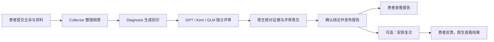

# MedConsensus

MedConsensus 是供医生和患者协作的问诊工作台。患者提交主诉和检查资料，多模型给出初诊和评审意见。医生核对原始证据、确认并发布报告，患者可以查看对应版本并提交复诊结果。

> ⚕️ AI 结果用于辅助医生判断。最终诊断和用药建议须由具备资质的医生确认。

[English](README.en.md) · [项目说明](docs/project-guide.md) · [部署指南](docs/deployment.md) · [MIT License](LICENSE)

[](https://www.oracle.com/java/)
[](https://spring.io/projects/spring-boot)
[](https://react.dev/)
[](https://vite.dev/)
[](https://www.postgresql.org/)

## 🧭 选择入口

| 目标 | 入口 | 结果 |
| --- | --- | --- |
| 本地体验完整工作台（推荐） | [本地开发](#-本地开发) | 在 `http://localhost:5173` 打开 React 界面 |
| 配置微信或 QQ 登录 | [网站应用配置](docs/deployment.md#启用微信或-qq-网站登录) | 在登录页启用已配置的平台 |
| 了解生产部署 | [部署指南](docs/deployment.md) | Docker Compose、环境变量、健康检查与升级说明 |

## 🔎 核心流程



诊断进度通过 STOMP WebSocket `/ws/diagnosis` 推送到当前用户的 `/user/queue/pipeline`。

## ✨ 在工作台中可以做什么

- **按角色登录。** 登录和注册时先选医生或患者。除手机号和密码外，可分别启用微信扫码和 QQ 登录。首次授权时，用户用所选角色的本地账号和密码确认绑定。同一第三方账号可以分别绑定两个角色。
- **核对检查依据。** 上传 PDF、Word（DOCX）或 JPG/PNG 原件。医生可以从识别出的检验数值打开对应原页，查看识别范围并校正文本。无法定位的条目会显示提示。
- **处理待办和评审分歧。** 医生可以按待核资料、待复核、待发布或待看随访筛选问诊。评审超时会保留其他模型的有效意见。高风险或三名评审中有效票不足两票时，流程转入人工复核。
- **发布和更正报告。** 复核前可以导出标明状态的草稿。每次发布保存一份报告及其证据快照，后续更正需重新发布。患者可查看历次版本，随访结果保留在发起随访的报告版本下。
- **回看历史问诊。** PostgreSQL 保存完整消息、诊断和已确认资料。归档会话后仍可查看历史报告。模型只读取近期上下文。

## 🧱 技术栈

| 层 | 组件 |
| --- | --- |
| 后端 | Java 17、Spring Boot 3.3.0、Spring AI OpenAI Starter 1.0.0-M6、LangGraph4j 1.5.14 |
| 前端 | React 18.3、Vite 5、STOMP WebSocket |
| 数据与基础设施 | PostgreSQL + pgvector、Redis、Neo4j、Docker Compose |
| 观测与文档 | OpenTelemetry、LangSmith（可选）、PDFBox、Apache POI |

## 🚀 本地开发

### 前置条件

- Java 17、Maven
- Node.js 20（前端构建使用）
- PostgreSQL、Redis 和 Neo4j。使用容器部署时需要 Docker Compose v2。
- 真实模型调用使用 `API_KEY` 和 `OPENAI_API_KEY`。Treatment Agent 使用的模型密钥为 `MIMO_API_KEY`。

### 1. 准备依赖服务

从宿主机运行 Maven 时，先准备可直接连接的 PostgreSQL、Redis 和 Neo4j。默认地址分别为 `localhost:5432`、`localhost:6379` 和 `bolt://localhost:7687`。创建 PostgreSQL 业务库 `medconsenus`，应用启动时会用 Flyway 建表并执行迁移。导入向量语料还需要带 pgvector 扩展的 `vector_db`。

仓库的部署用 Compose 通过容器网络连接服务，数据库端口默认只对容器开放。要让整个应用在容器中运行，请按部署指南配置环境变量和入口。[部署指南](docs/deployment.md)

### 2. 启动后端

在仓库根目录打开终端。为当前进程设置 `POSTGRES_PASSWORD` 和 `NEO4J_PASSWORD`，账号、地址或端口有差异时见下方配置表。使用向量库时设置 `PGVECTOR_PASSWORD`，运行真实模型时提供对应的模型密钥。

```bash
mvn spring-boot:run
```

后端监听 `8086`。通过健康检查确认服务已启动。

```bash
curl http://127.0.0.1:8086/actuator/health
```

### 3. 启动前端

另开终端：

```bash
cd frontend
npm ci
npm run dev
```

访问 `http://localhost:5173`。Vite 已将 `/api` 和 `/ws` 代理到 `http://127.0.0.1:8086`。

构建前端静态资源（输出到 Spring Boot 的静态目录）：

```bash
npm run build
```

在 `frontend` 目录运行前端测试，回到仓库根目录运行后端测试。后端集成测试需要独立的 PostgreSQL 测试库和 Redis 实例。

```bash
node --test
cd ..
mvn test
```

## ⚙️ 配置

主要配置位于 `src/main/resources/application.yml`，生产环境建议通过环境变量注入：

| 变量 | 用途 |
| --- | --- |
| `API_KEY` | DashScope 兼容接口，Collector、Reviewer、Decision、Embedding 等使用 |
| `OPENAI_API_KEY` | GPT 诊断/评审与视觉模型 |
| `MIMO_API_KEY` | Treatment Agent |
| `SPRING_DATASOURCE_URL`、`POSTGRES_USER`、`POSTGRES_PASSWORD` | PostgreSQL 业务库 |
| `REDIS_HOST`、`REDIS_PORT` | Redis 并发锁、报告解释缓存与旧会话迁移 |
| `NEO4J_URI`、`NEO4J_USER`、`NEO4J_PASSWORD` | 医学知识图谱 |
| `WECHAT_LOGIN_ENABLED`、`QQ_LOGIN_ENABLED` | 微信和 QQ 网站登录各自的开关，默认关闭。启用时须配置该平台的 AppID、密钥和 HTTPS 回调地址 |
| `LANGSMITH_ENABLED`、`LANGSMITH_API_KEY` | 可选 LangSmith 追踪 |

部署环境变量可参考 [Compose 配置示例](docker/deploy/.env.example)。微信和 QQ 的应用凭据只配置在服务端。配置完成后可通过 `GET /api/auth/social/providers` 核对当前启用的平台。[第三方登录配置与回调地址](docs/deployment.md#启用微信或-qq-网站登录)

## 🔌 常用接口

| 领域 | 路径 |
| --- | --- |
| 认证 | `POST /api/auth/register`、`POST /api/auth/login`、`GET /api/auth/me`、`POST /api/auth/logout` |
| 医生工作台 | `/api/workspace/patients`、`/api/workspace/sessions`、`/api/workspace/consultations`、`/api/workspace/doctor-review` |
| 患者端 | `/api/patient/dashboard`、`/api/patient/consultations`、`/api/patient/reports/{reportId}/explanations` |
| 医患协作 | `/api/workspace/collaboration`、`/api/workspace/diagnosis-records/{recordId}/publish` |
| 报告证据与随访 | `GET /api/evidence/reports/{reportId}/revisions/{revision}`、`GET /api/workspace/follow-ups`、`GET /api/patient/follow-ups` |
| 实时进度 | STOMP `/ws/diagnosis`，订阅 `/user/queue/pipeline` |

业务流程与数据模型见 [项目说明](docs/project-guide.md)。

## 🗂️ 项目结构

```text
frontend/                         React + Vite 前端
src/main/java/com/zyt/medconsensus
  agent/ graph/ graphkg/ rag/     Agent、工作流、知识图谱、向量存储与导入
  controller/ service/            REST API 与业务编排
  llm/ observability/             多模型网关与追踪
src/main/resources/               Spring Boot 配置、迁移与静态资源
docker/                           Dockerfile、Compose、PostgreSQL 初始化
docs/                             项目说明与部署文档
```

## 📚 文档与贡献

- [项目说明](docs/project-guide.md)：模块、流程、接口、数据存储和开发约定。
- [部署指南](docs/deployment.md)：Compose 部署、环境变量、健康检查、备份与排障。
- 欢迎提交 Issue 或 Pull Request；涉及医疗建议的改动请保留医生复核语义。

## 📄 许可证

本项目采用 [MIT License](LICENSE)。
